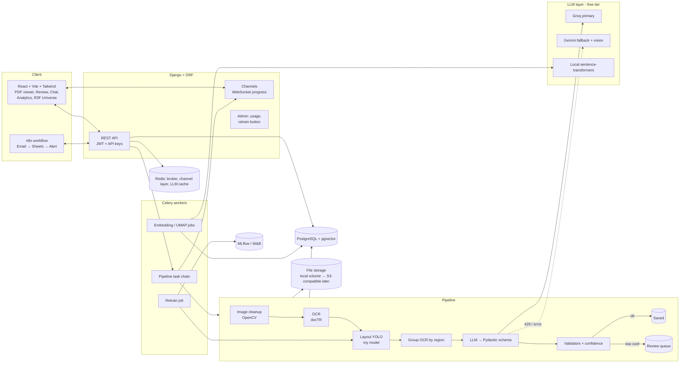

# DocSense — Project Plan

AI document intelligence for invoices and receipts: structured extraction with a self-trained layout model, validation in code, human review with active learning, cited RAG, a spending agent, fraud/anomaly detection, a 3D document universe, and n8n automation. Free-tier only.

Status: **PLAN — awaiting approval. No code written yet.**

---

## 1. Guiding principles

1. **Demo early, advanced later.** A working upload → extract → review loop exists by M2/M3. The ML-heavy parts plug into it afterwards.
2. **The LLM never does arithmetic or format checks.** Python validators decide; the LLM only fills a schema.
3. **Every claim in the README is a number from a script in the repo** (`make eval`), not hand-typed.
4. **Tests run offline.** All LLM calls go through one interface with a `FakeChatModel`; OCR and YOLO have fake/stub adapters for unit tests; heavy model tests are marked `@pytest.mark.slow` and excluded from CI by default.
5. **Swappable seams**: `OCREngine`, `LayoutDetector`, `LLMClient`, `Embedder`, `Storage`. Each has a real and a fake implementation.

---

## 2. Architecture



### Key technology choices

| Concern | Choice | Why |
|---|---|---|
| OCR | **docTR** (PyTorch) — *recommended, see decision D1* | Same framework as the rest of the ML stack (one torch install, not torch + paddlepaddle), clean Python API, word-level boxes with confidences (needed for field highlighting and confidence scoring), good CPU speed with `db_mobilenet_v3_large` + `crnn_mobilenet_v3_small`. PaddleOCR is stronger on multilingual/Urdu but pulls in a second DL framework that is painful on Windows and bloats Docker. Wrapped behind `OCREngine`, so PaddleOCR can be added later and compared in the eval. |
| Layout model | Ultralytics YOLO (v8/11 nano or small) | Fast to fine-tune on CPU/free Colab GPU. Note **AGPL-3.0 licence** — fine for a portfolio, documented in README. |
| Experiment tracking | **MLflow** (local, in docker-compose) — *D2* | No account/network needed, reproducible for reviewers. W&B optional via a flag. |
| Vector search | pgvector (HNSW) + Postgres `tsvector` full-text | One database; hybrid fusion with Reciprocal Rank Fusion. |
| Re-ranking | Local cross-encoder (`cross-encoder/ms-marco-MiniLM-L-6-v2`) on top-20 | Free, CPU-feasible. |
| Embeddings | `sentence-transformers/all-MiniLM-L6-v2` (384-d) | Small, free, local. Multilingual variant optional if Urdu docs matter. |
| LLM | `langchain.chat_models.init_chat_model` → Groq (primary), Gemini (fallback) | Model names kept in settings/env since free-tier model lineups change. |
| Anomaly | Robust z-score + IsolationForest, imagehash pHash, rapidfuzz | Explainable first, ML second. |
| 3D | React Three Fiber + drei, `InstancedMesh`, UMAP (umap-learn) computed server-side | |
| Background | Celery + Redis. `CELERY_TASK_ALWAYS_EAGER` mode for tests and free hosting without a worker. | |

---

## 3. Folder structure

```
docsense/
├── PLAN.md  README.md  LICENSE  Makefile  docker-compose.yml  .env.example
├── .github/workflows/ci.yml            # lint + tests (backend, frontend, ml-lite)
├── backend/
│   ├── manage.py  pyproject.toml  pytest.ini
│   ├── config/                         # settings (base/dev/test/prod), asgi, celery, urls
│   └── apps/
│       ├── accounts/                   # user, JWT auth, signup/login
│       ├── workspaces/                 # workspace, membership+roles, API keys, usage, limits
│       ├── documents/                  # Document, Page, Extraction, FieldValue, upload API
│       ├── pipeline/                   # steps: cleanup, ocr, layout, group, extract, validate, confidence; Celery chain; progress events
│       ├── validation/                 # pure-Python rules (no Django imports) + tests
│       ├── llm/                        # LLMClient, fallback/backoff, rate-limit header handling, cache, usage logging, FakeChatModel
│       ├── rag/                        # chunking, embeddings, hybrid search, rerank, answer+citations, groundedness
│       ├── agent/                      # LangGraph spend agent, safe query tool, chart tool
│       ├── analytics/                  # duplicates, anomalies, price creep, aggregate endpoints, UMAP universe
│       ├── review/                     # corrections, labeled-sample export, retrain trigger
│       ├── integrations/               # webhooks (HMAC-signed), n8n-facing endpoints
│       ├── evaluation/                 # stored eval runs + API for eval page
│       └── common/                     # permissions, throttles, pagination, utils
├── ml/                                 # installable package `docsense_ml` (separate lightweight deps)
│   ├── synth/                          # templates/*.html, generator (Faker+Playwright render), label writer
│   ├── augment/                        # Albumentations pipelines + before/after sample script
│   ├── train/                          # dataset.yaml builders, train.py, compare.py, mlflow logging
│   ├── data/                           # loaders for SROIE/CORD, my own labeled set (DVC-less, small, git-ignored large)
│   ├── eval/                           # layout mAP, extraction P/R/F1, RAG eval, LLM judge
│   ├── models/                         # registry.json + current/previous weights (git-ignored; tiny model on Releases)
│   └── notebooks/                      # 01_eda_invoices.ipynb, 02_anomaly_methods.ipynb, 03_synth_vs_real.ipynb
├── frontend/
│   ├── src/ (pages/, components/, features/{upload,review,chat,analytics,universe,admin}, api/, ws/, hooks/)
│   └── vitest + playwright smoke tests
├── n8n/  invoice-intake.workflow.json  README.md
├── seed/  demo_workspace/ (≈50 synthetic docs + ground truth), seed_demo management command
└── docs/  images/ (screenshots, GIF placeholders), eval-results/ (JSON/CSV produced by scripts)
```

---

## 4. Data model (core tables)

- **User**(email, password, …)
- **Workspace**(name, slug, plan_limits JSON) · **Membership**(user, workspace, role ∈ owner/member/viewer)
- **ApiKey**(workspace, name, prefix, hashed_key, last_used_at, revoked_at) — shown once, stored hashed.
- **WebhookEndpoint**(workspace, url, secret, events[]) · **WebhookDelivery**(status, attempts)
- **Document**(workspace, uploader, file, sha256, phash, doc_type, status ∈ queued/processing/needs_review/done/failed, page_count, created_at)
- **Page**(document, number, image, width, height, ocr_json, cleaned_image)
- **Region**(page, class ∈ vendor/meta/table/totals/other, bbox, score, source ∈ model/human)
- **TextBlock**(page, text, bbox, ocr_conf, region FK nullable)
- **Extraction**(document, version, model_versions JSON, schema_json, overall_confidence, status, llm_provider, tokens_in/out)
- **FieldValue**(extraction, name, value, normalized_value, bbox, page, confidence, flags[], reviewed_by, reviewed_value)
- **Invoice** (denormalised, query-friendly, what the agent may read): vendor_name, vendor_id FK, ntn, strn, invoice_number, invoice_date, currency, subtotal, tax_rate, sales_tax, total, category
- **Vendor**(workspace, canonical_name, aliases[], ntn)
- **LineItem**(invoice, description, qty, unit_price, amount, normalized_item)
- **Chunk**(document, page, text, bbox, embedding vector(384), tsv tsvector)
- **Flag**(document, kind ∈ exact_dup/near_dup/image_dup/amount_outlier/price_creep/validation, severity, evidence JSON, resolved)
- **UniversePoint**(document, x, y, z, cluster_id, cluster_label)
- **TrainingSample**(document, image, labels_yolo, field_labels, source ∈ synthetic/real_labeled/human_correction, approved)
- **ModelVersion**(name, path, metrics JSON, mlflow_run_id, is_active)
- **LLMUsage**(provider, model, workspace, doc, tokens_in/out, latency, status, cache_hit, ts) · **LLMCache**(key=hash(prompt+schema+model), response, ts)
- **EvalRun**(kind ∈ extraction/layout/rag, config, metrics JSON, created_at, git_sha)

All workspace-owned tables carry `workspace_id`; a `WorkspaceScopedManager` plus DRF mixin makes cross-tenant access impossible by default (and tests assert it).

---

## 5. Processing pipeline

```
upload ──► [1 cleanup] ─► [2 OCR] ─► [3 layout] ─► [4 group] ─► [5 LLM extract] ─► [6 validate] ─► [7 confidence] ─► [8 persist/route] ─► [9 embed+index] ─► [10 anomaly checks]
```

1. **Cleanup** (OpenCV): PDF → images (pypdfium2, 200 dpi), deskew (minAreaRect / Hough), denoise (fastNlMeans, light), CLAHE contrast, optional perspective rectification of the paper quad for phone photos. Original is always kept.
2. **OCR**: docTR → words with boxes + confidence; for digital PDFs with a text layer, use the embedded text and skip OCR (faster, exact).
3. **Layout**: YOLO → regions {vendor, meta, table, totals, other}. If the model is unavailable or low confidence → fallback to "whole page as one region" (this is also the *ablation baseline*).
4. **Group**: assign each OCR word to the region with largest overlap; sort reading order; produce per-region text blocks.
5. **LLM extraction**: LangChain `with_structured_output(InvoiceSchema)`. Prompt contains only per-region text (labelled `[VENDOR]`, `[META]`, `[TABLE]`, `[TOTALS]`). Cached by hash. Groq first; on 429 → read `retry-after`/rate-limit headers and wait (bounded), retry with exponential backoff + jitter, then fail over to Gemini. For very low OCR confidence or empty result, Gemini vision on the cropped image is the last resort.
6. **Validation (pure Python)**: 
   - Σ(qty × unit_price) ≈ each line amount; Σ line amounts ≈ subtotal (tolerance Rs 1 / 0.5%).
   - sales_tax ≈ subtotal × stated rate (default 18%); rate inferred from text if present.
   - total ≈ subtotal + sales_tax (− discount + other charges when present).
   - NTN / STRN format checks (see risk R6), date parses, not in future, not older than a configurable window.
   - Currency defaults to PKR.
7. **Confidence per field** = weighted combination of: OCR word confidences under the field's bbox, whether the value string literally appears in OCR text (grounding check), validator pass/fail, LLM-provider agreement (when a second pass was run), and layout score. Failed rule → multiplicative penalty + flag on the *implicated* fields. Weights live in config and are calibrated on the labeled set (reliability plot in the notebook).
8. **Route**: all fields ≥ threshold and no failed hard rules → `done`; else `needs_review`. Webhook fired either way.
9. **Index**: chunk with page + bbox, embed locally, store.
10. **Anomaly checks**: duplicates, outliers, price creep → `Flag` rows.

Each step publishes `{document_id, step, status, detail, ts}` over Channels group `workspace.<id>.doc.<id>`; UI shows a live stepper. Steps are idempotent and resumable (step results persisted).

---

## 6. API endpoints (v1, DRF; JWT for UI, `X-API-Key` for machines)

**Auth/SaaS**: `POST /auth/signup`, `/auth/login`, `/auth/refresh`, `GET /me` · `GET/POST /workspaces`, `GET/PATCH /workspaces/{id}` · `GET/POST/DELETE /workspaces/{id}/members` · `GET/POST/DELETE /workspaces/{id}/api-keys` · `GET /workspaces/{id}/usage` · `GET/POST /workspaces/{id}/webhooks`

**Documents**: `POST /documents` (multipart, multi-file) · `GET /documents?status=&type=&vendor=&q=` · `GET /documents/{id}` · `GET /documents/{id}/pages/{n}/image` · `GET /documents/{id}/extraction` · `PATCH /documents/{id}/fields/{name}` (correct a value/box) · `POST /documents/{id}/approve` · `POST /documents/{id}/reprocess` · `DELETE /documents/{id}`
**Review**: `GET /review/queue` · `PUT /documents/{id}/regions` (fix layout boxes)
**RAG**: `POST /chat/ask {question, document_ids?}` → `{answer, grounded, citations:[{doc,page,bbox,quote}]}` · `GET /chat/sessions`
**Agent**: `POST /agent/ask` (SSE stream of steps) → `{answer, steps:[{tool,input,rows_preview}], charts:[…]}`
**Analytics**: `GET /analytics/spend?group_by=month|vendor|category` · `GET /analytics/flags` · `PATCH /analytics/flags/{id}` (resolve) · `GET /analytics/vendors/{id}/price-history`
**Universe**: `GET /universe/points` · `POST /universe/rebuild`
**Eval/Admin** (staff or workspace owner as noted): `GET /evaluation/runs` · `POST /evaluation/run` · `GET /admin/llm-usage` · `POST /admin/retrain` · `GET /admin/models` · `POST /admin/models/{id}/activate`
**Integration**: `POST /integrations/inbound` (n8n-friendly: file + metadata, API key) · outbound signed webhook `document.processed`, `document.flagged`
**WebSocket**: `ws /ws/documents/{id}/` and `ws /ws/workspace/` (progress, flags)

Permissions matrix tested in code: viewer = read-only; member = upload/review/chat; owner = members, keys, webhooks, retrain.
Rate limits: DRF throttles per user + per API key; upload quota per workspace/day and per file size.

---

## 7. Frontend pages

1. **Landing / login / signup** (+ "Try demo" button logging into the seeded workspace).
2. **Dashboard** — recent docs, review queue count, spend this month, flags.
3. **Upload** — drag/drop, camera capture on mobile, live pipeline stepper per file (WebSocket).
4. **Documents list** — filters, status chips, confidence badge.
5. **Review** — split view: PDF/image viewer with field overlays (colour by confidence), editable form, draw/adjust boxes and layout regions, approve/skip.
6. **Document detail** — viewer + extracted data + flags + audit trail.
7. **Ask** (RAG chat) — citations as chips; click jumps the viewer to page and highlights source bbox; "not found in your documents" state.
8. **Spending assistant** (agent chat) — shows the step trace, SQL-like query plan/rows used, and inline charts (Recharts).
9. **Analytics** — spend over time/vendor/category, flagged items table, vendor price history.
10. **Universe** — R3F scene (instanced points, UMAP 3D, labelled clusters, hover card, click to open, auto-fallback to 2D scatter if FPS < ~30 or no WebGL2).
11. **Settings** — members & roles, API keys, webhooks, usage vs. limits.
12. **Evaluation** — tables/charts of extraction, layout and RAG metrics, run history.
13. **Admin** (staff) — LLM usage per provider, model registry, retrain + compare button.

PDF viewer: `react-pdf` (pdf.js) + custom overlay layer in page coordinates (normalised bbox 0–1 so it survives zoom/DPI).

---

## 8. ML training plan

### 8.1 Synthetic invoice generator
- 6–8 HTML/CSS templates (thermal receipt, FBR-style tax invoice, GST invoice, retail POS, wholesale, service invoice with Urdu shop name header, two-column layout, hand-stamped variant), parameterised by Jinja2.
- Faker locale `en_PK` plus custom providers: Pakistani business names/cities, NTN/STRN generators that satisfy the format validators, PKR amounts, 18% GST, line items from a small product catalogue per category (also yields category labels for analytics).
- Rendered with Playwright (Chromium) → PNG/PDF. Region boxes read from the DOM (`data-region` attributes → `getBoundingClientRect`) so labels are exact; field-level boxes and ground-truth JSON are emitted too (used for extraction eval and for RAG/analytics seed data).
- Output: YOLO-format dataset (`images/`, `labels/`, `data.yaml`) + `truth.jsonl`. Target: 6k train / 600 val synthetic images; deterministic via seed.

### 8.2 Augmentation (Albumentations)
Applied on-the-fly at training and offline for the demo set: rotation ±15°, perspective warp, Gaussian/motion blur, random shadow, brightness/gamma (low light), JPEG compression 30–90, paper-texture overlay (procedural noise + a few CC0 textures), crease lines, stains (blobs with alpha), partial crops (keeping box clipping rules), occasional background (desk/table) padding. Bbox-aware (`bbox_params`). `ml/augment/preview.py` writes a before/after grid to `docs/images/augmentation.png`.

### 8.3 YOLO fine-tuning
- Base: `yolo11n` / `yolov8n` (try `s` if time). 5 classes. imgsz 640 (try 960 for dense receipts).
- Hardware: CPU for the nano smoke run; real training on free Colab/Kaggle T4 (script is the same; a `colab.ipynb` wrapper is provided). Weights committed only if small (<10 MB) or attached to GitHub Release.
- MLflow logs params, metrics per epoch, confusion matrix, sample predictions, weights artifact. Experiments: (a) no augmentation, (b) basic aug, (c) full aug, (d) full aug + N real samples.

### 8.4 Real-data evaluation and the synthetic→real gap
- Real sets: **SROIE** (ICDAR 2019; Malaysian receipts; licence: no explicit open licence — research use; must re-verify before commit and note in README, do **not** redistribute images in the repo) and **CORD-v2** (CC BY 4.0; Indonesian receipts, has line-item/tax/total structure). Neither provides my 5 region classes.
- Therefore I **hand-label ~80–120 real receipts** for region boxes (tool: CVAT or Label Studio export, or my own Review screen) — split 40 for gap-closing/finetune, 60 held-out test. Ideally include real Pakistani invoices/phone photos you provide (redacted).
- Report **mAP@50 per class** on (i) synthetic val, (ii) real test, then after each mitigation: heavier augmentation, adding few-shot real samples, mixing ratios (0/10/20/40 real), higher imgsz. A short write-up with a table, failure-case gallery and what moved the number goes into README + `notebooks/03_synth_vs_real.ipynb`.

### 8.5 Extraction with vs. without layout model
Same test set, same LLM, same prompt skeleton. Arm A: whole-page OCR text. Arm B: region-grouped text (my model). Arm C (upper bound): ground-truth regions. Metrics in §9. Report deltas **and** token usage (region grouping should also cut tokens).

### 8.6 Other ML / DS pieces
- Confidence calibration: logistic regression over field-level signals vs. "was field correct" on the labeled set (scikit-learn); compare to hand-tuned weights.
- Anomaly: IsolationForest on per-vendor features vs. robust z-score (MAD) baseline, compared on injected anomalies (synthetic perturbations with known labels) → precision/recall in notebook.
- Clustering for the universe: sentence embeddings → UMAP(3D) → HDBSCAN → cluster labels via TF-IDF top terms (LLM labelling optional/cached).

---

## 9. Evaluation plan

| Area | Metric | Dataset | How |
|---|---|---|---|
| Layout | mAP@50 per class, mAP@50-95 overall | synthetic val; real test (hand-labeled) | `python -m docsense_ml.eval.layout` |
| Extraction | field-level precision / recall / F1 (normalised exact match; fuzzy for vendor), total exact-match rate, validation-pass rate, review-rate, flag precision | CORD + SROIE test subset + my labeled PK set + synthetic holdout (reported separately) | `eval.extraction` with `--arm A|B|C` |
| Confidence | calibration (ECE), % of wrong fields caught by review routing | same | |
| RAG | answer correctness (judge 1–5 + exact-fact check where possible), citation accuracy (cited page/bbox actually contains the evidence), abstention accuracy on unanswerable Qs | `eval/rag_questions.yaml` (extendable: id, question, doc_ids, gold_answer, gold_pages, category) | LLM judge on **the other provider** than the answerer |
| Free-tier cost | tokens / doc, requests / doc, cache hit rate | all | from `LLMUsage` |

Judge rules: if Groq answers, Gemini judges (and vice-versa, configurable); one category per run; fixed sleep between calls; results cached by (question, answer, judge-prompt) hash; deterministic temperature 0; judge prompt versioned. Results stored in `EvalRun` + `docs/eval-results/*.json`, rendered on the Evaluation page, and pasted into README by `make readme-tables`.

---

## 10. Free-tier constraints and how the design respects them

- **Groq / Gemini free quotas** (RPM, RPD, TPM change over time → configurable limits in `.env`, a token-bucket limiter in `llm/`, and header-aware waiting: read `retry-after` / `x-ratelimit-*`, sleep up to a cap, else fail over, else queue the doc with status `waiting_for_quota`).
- Small prompts: region text only, no raw whole document; table region compacted to TSV-like lines; max-token caps; JSON-schema output.
- Cache by `sha256(file) + pipeline_version + prompt_version`; reprocessing is free.
- Local embeddings/rerank/UMAP/OCR/YOLO = zero API cost.
- Only demo/synthetic data goes to external APIs; real user uploads in the hosted demo are disabled or warned ("don't upload sensitive docs"), and a `LLM_PROVIDER=fake|local` switch exists. Eval on real receipts (public datasets) is fine; any private PK invoices you provide are **not** sent to Groq/Gemini unless you OK it (see D6).
- Admin usage page: requests/tokens/latency/429s per provider per day.
- Hosting later (free): Vercel/Cloudflare Pages (frontend), Render/Fly/Koyeb (API; 512 MB RAM is tight for docTR + torch → eager mode, ONNX/CPU, lazy model loading, or run OCR in HF Spaces), Neon/Supabase (Postgres + pgvector), Upstash (Redis). Documented in README as "deployment notes"; local docker-compose is the primary reference setup.

---

## 11. Risks and mitigations

| # | Risk | Mitigation |
|---|---|---|
| R1 | Free-tier rate limits stall demos/evals | Cache, limiter, fallback, fake model for tests, pre-computed seed extractions for the demo workspace |
| R2 | Synthetic→real gap makes the layout model weak | Heavy aug, few-shot real mix, honest reporting; fallback to whole-page when region confidence is low; the gap write-up *is* the story |
| R3 | Only a few real PK invoices available; no region labels in SROIE/CORD | Budget time for hand-labeling ~100 images; accept SROIE/CORD for extraction fields, own labels for layout |
| R4 | Dataset licence issues (SROIE unclear) | Don't redistribute; download script + README note; prefer CORD (CC BY 4.0) for anything shown in the UI |
| R5 | Heavy deps (torch, docTR, ultralytics) → slow CI and big Docker images | Separate `requirements` extras; CI runs fast tests with fakes; `slow` tests on demand; CPU-only torch wheels |
| R6 | NTN/STRN formats vary (NTN 7 digits + check digit, or CNIC-based 13 digits; STRN 13 digits or legacy 17-digit `00-00-0000-000-00`) | Rules live in one module, documented, easy to update; I'll verify against FBR docs before M2 and flag any uncertainty |
| R7 | Urdu text not read well by docTR | Urdu only appears in shop-name headers; treated as non-critical, not graded; OCR adapter allows PaddleOCR later |
| R8 | LLM prompt-injection from document text | Strict schema output, text delimited as data, no tool use in extraction; agent tools are read-only/whitelisted/workspace-scoped in code |
| R9 | Agent safe-query tool escapes tenant boundary | Tool takes a structured query spec (table, columns, filters, group_by, agg), **not raw SQL**; compiled via Django ORM from a whitelist; `workspace_id` filter injected in code; DB role read-only; tests with adversarial specs |
| R10 | Scope is very large | Milestones are independently demoable; M0–M3 is already a complete portfolio piece; later milestones cut from the bottom if time runs out (n8n and 3D are the most isolated) |
| R11 | 60 fps 3D on weak devices | InstancedMesh, no per-frame allocations, LOD labels, FPS monitor → 2D fallback |
| R12 | Ultralytics AGPL-3.0 | Note in README; repo is open source; alternative detector (RT-DETR via other lib) mentioned as future work |
| R13 | Windows dev environment quirks | Everything runs via docker-compose; local-dev instructions tested on Windows (PowerShell) |

---

## 12. Milestones

Each milestone ends with: runnable demo, passing tests, README section updated, a clean git commit (conventional message). CI green is required before moving on.

| # | Milestone | Demo at the end | Key tests |
|---|---|---|---|
| **M0** | **Foundations**: repo, docker-compose (Django, Postgres+pgvector, Redis, Celery, MLflow, frontend), settings split, lint (ruff, black, eslint, prettier), pre-commit, GitHub Actions, `LLMClient` interface + `FakeChatModel`, health endpoint, React shell | `docker compose up` → health page; CI badge green | health test, lint, FakeChatModel unit test |
| **M1** | **SaaS core**: signup/login (JWT), workspaces, memberships/roles, API keys, usage counters, upload limits, DRF throttling, base permissions | Create account, workspace, invite viewer, create API key, hit API with key | permission matrix tests (owner/member/viewer/anonymous/cross-tenant), key hashing, throttle |
| **M2** | **Extraction slice v1** *(first real demo)*: upload → cleanup → OCR → whole-page text → LLM (Groq→Gemini fallback, cache, backoff) → Pydantic schema → validators → confidence → status; WebSocket step progress; simple documents list + result page | Upload an invoice photo, watch live steps, see structured JSON + flags | validator unit tests (arithmetic, tax, NTN/STRN, dates), LLM fallback/429 tests with fake, pipeline test with stub OCR, WS consumer test |
| **M3** | **Review & viewer**: PDF/image viewer with field highlights, review queue, edit fields, approve, audit trail | Fix a low-confidence field with highlight, approve; invoice rows saved | field PATCH permissions, state transitions, overlay coordinate tests (vitest) |
| **M4** | **Eval harness & baseline**: dataset loaders (CORD/SROIE download scripts), labeled-set format, extraction metrics, `make eval`, Evaluation page (basic) | **Baseline F1 numbers** on real receipts, no layout model | metric functions with hand-computed cases; deterministic eval with fake LLM |
| **M5** | **Synthetic generator + augmentation**: templates, Faker providers, Playwright render, exact labels; Albumentations pipeline; preview grid | 1k-image YOLO dataset generated + before/after augmentation image | label geometry tests (boxes inside image, no NaN), determinism by seed, validator-passing generated NTN/STRN |
| **M6** | **Layout model training**: train script, MLflow tracking, experiments a–d, hand-labeled real test set tooling, mAP@50 per class, gap analysis | MLflow UI with runs; table synthetic vs real mAP; failure gallery | mAP computation test on toy boxes, dataset yaml builder, smoke-train 1 epoch on 20 images (slow-marked) |
| **M7** | **Integrate layout into pipeline** + ablation: region grouping, fallback, region overlay in UI | **Before/after extraction F1 + tokens/doc** (arms A/B/C) | grouping by overlap tests, fallback tests with stub detector |
| **M8** | **Human review → active learning**: region box editing, corrections → `TrainingSample`, `manage.py retrain`, admin button, model comparison + activate/rollback | Correct 10 docs, retrain, see new vs old mAP, switch active model | sample export format tests, registry/activation tests, retrain job with stub trainer |
| **M9** | **RAG**: chunking w/ page+bbox, local embeddings, hybrid search (pgvector + FTS, RRF), cross-encoder rerank, cited answers, abstention, citation → viewer highlight | Ask questions, click citation → page highlighted; unanswerable question → "not in documents" | chunker keeps bbox/page, RRF unit tests, abstention logic with fake LLM, citation-accuracy eval on seed Qs |
| **M10** | **Anomaly & analytics**: exact/near/pHash duplicates, outliers (MAD + IsolationForest), price creep, analytics page, EDA notebook | Seed with injected anomalies → flags appear, charts render | detector tests on synthetic anomalies (precision/recall thresholds), tenant scoping |
| **M11** | **Spending agent**: LangGraph graph, safe query tool (spec → ORM), chart tool, doc-search tool, step trace UI, inline charts | "How much per vendor last quarter?" → table+chart+trace | query-spec whitelist/injection tests, workspace-filter enforcement, graph run with fake model, no-write guarantee |
| **M12** | **3D universe**: UMAP 3D job, R3F instanced scene, hover/click, labels, FPS monitor + 2D fallback | Fly through the document cloud | projection job tests, API shape; frontend component tests; manual FPS check recorded |
| **M13** | **n8n + integrations**: signed webhooks, inbound endpoint, workflow JSON export (email → API → Sheets → alert), docs | Send an email with attachment → row in Sheet + Slack/email alert on flagged | webhook HMAC & retry tests, inbound endpoint auth tests, workflow JSON schema sanity check |
| **M14** | **Evaluation page, admin usage, seed, README, deploy notes**: RAG eval + judge, eval dashboard, LLM usage admin page, `seed_demo` (≈50 docs + demo login), one-command setup, screenshots/GIF placeholders, "what I'd improve next" | `docker compose up` → fully seeded demo workspace; README with real tables | seed idempotency test, judge-provider-differs test, rate-limit pacing test |

Rough effort (solo, part-time): M0–M3 ≈ 2 weeks, M4–M8 ≈ 3–4 weeks, M9–M11 ≈ 3 weeks, M12–M14 ≈ 2 weeks. M0–M3 is a shippable portfolio piece on its own.

---

## 13. Testing and CI

- **Backend**: pytest + pytest-django; factories; `FakeChatModel` returns scripted structured outputs; OCR/Layout/Embedder fakes; no network (pytest-socket blocks it).
- **ML**: pure-function tests for metrics/geometry/generators; heavy tests marked `slow`.
- **Frontend**: Vitest + React Testing Library; Playwright smoke (login → upload with mocked backend) optional in CI.
- **CI** (GitHub Actions): ruff + black --check + mypy (light) · pytest (Postgres+pgvector and Redis services) · eslint + tsc + vitest · build Docker images (no push).
- Coverage report; threshold only on `validation/`, `llm/`, `accounts/workspaces` permissions.

---

## 14. Decisions I need from you

| # | Question | My recommendation |
|---|---|---|
| **D1** | OCR engine: docTR vs PaddleOCR | **docTR** (PyTorch consistency, easier Docker/Windows). Keep adapter so PaddleOCR can be benchmarked later. |
| **D2** | Tracking: MLflow vs W&B | **MLflow** locally (no account, reproducible); optional W&B flag. |
| **D3** | Where does the project live? Current folder is `AI video editor`; I put the plan in `docsense/` inside it. | New standalone git repo at `docsense/` (or a different path you prefer). Confirm path and the GitHub repo name. |
| **D4** | GPU for training? | If you have no local GPU, I'll use Colab/Kaggle notebooks for M6/M8 with the same scripts; CPU only for smoke runs. Do you have a local NVIDIA GPU? |
| **D5** | Real data: can you supply some real Pakistani invoices/receipts (phone photos, redacted if needed)? ~30 would be very valuable; ~60–100 for region labeling incl. public receipts. | Yes please, plus CORD for public evaluation. |
| **D6** | May real/private PK invoices be sent to Groq/Gemini for eval? | **No** by default; use only public/synthetic data with cloud LLMs, local-only for private files (a local Ollama model option, if you have the RAM). |
| **D7** | Hand-labeling: OK to spend ~3–4 hours labeling ~100 receipt layouts (I'll provide the tooling and a labeling guide)? | Needed for an honest real-world layout mAP. |
| **D8** | Groq/Gemini: do you already have API keys? Preferred model families (I'll keep names configurable)? | Groq Llama 70B-class for text, Gemini Flash for fallback/vision. |
| **D9** | Currency/tax defaults: PKR + 18% GST, with provincial sales tax on services (e.g., PRA 16%, SRB 13%) as configurable rates? | Default 18%; allow `{0, 5, 13, 16, 17, 18}` and flag others as "unusual" rather than invalid. |
| **D10** | Languages: English-only extraction with Urdu shop names tolerated, or should Urdu fields be extracted too? | English-only fields; Urdu tolerated (non-graded). |
| **D11** | Frontend language: TypeScript or JavaScript? | **TypeScript**. |
| **D12** | Licence for the repo (MIT is fine; Ultralytics AGPL implications noted)? | MIT for my code; AGPL note for YOLO weights/usage. |
| **D13** | Scope cuts if time-boxed: which to cut first? | Cut order: n8n polish → 2D fallback polish → price-creep → Gemini vision fallback. |
| **D14** | Hosting target for later demo? | Frontend on Vercel; backend on Render/Fly with eager Celery; Neon Postgres. Decide at M14. |

---

## 15. What happens next

On your OK (and answers to D3–D8 at minimum, rest can default to my recommendations), I start **M0**, finish it with CI green and tests passing, show you the result, make a commit, and wait for your go-ahead before M1 — or continue straight on if you prefer.
