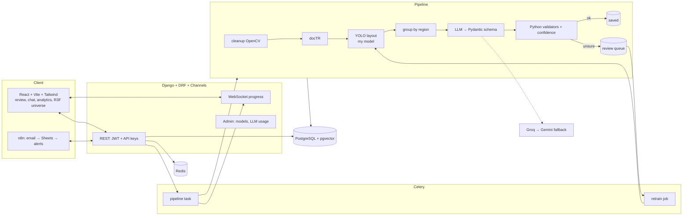

# DocSense

**AI document intelligence for invoices and receipts.** Upload a PDF or a phone photo: DocSense cleans the
image, reads it with a local OCR engine, finds the invoice layout with a **YOLO model I trained myself on
synthetic Pakistani invoices**, has an LLM fill a strict schema from each region's text, then **checks the
result with rules written in code** (line math, 18% GST, NTN/STRN formats, dates). Fields it is unsure about
go to a review screen where corrections become training data. It also answers questions about your documents
with page-level citations (and says "not found" instead of guessing), analyses spending with a LangGraph agent
that can only run whitelisted read-only queries, flags duplicates and suspicious invoices, and draws every
document as a point in a 3D universe. Everything runs on free tiers (Groq + Gemini, local open-source models).

| Review screen | Spending analytics |
|---|---|
|  |  |


> Placeholders for recordings: `docs/images/demo-upload.gif` (upload → live pipeline steps),
> `docs/images/demo-universe.gif` (3D universe), `docs/images/demo-chat.gif` (cited answers).

## Try it (one command)

```bash
cp .env.example .env            # optional: add GROQ_API_KEY / GOOGLE_API_KEY (free tiers)
docker compose up --build       # first build downloads the CPU ML stack (~3 GB)
```

Open http://localhost:5173 and sign in with the demo account **`demo@docsense.dev` / `docsense-demo-2025`**
(a public account on sample data). The first start migrates the database and seeds a **demo workspace with 50
sample documents** (planted duplicates, a price increase, an outlier, three documents waiting for review),
so every page has content with no API key, OCR run or LLM call. Uploading *new* documents needs a Groq or
Gemini key; browsing, reviewing, analytics, the universe, search retrieval and the evaluation page do not.

*Without Docker (Windows):* `scripts\dev-api.cmd` (SQLite, eager Celery, seeds the demo) and
`cd frontend && npm install && npm run dev`. `docker build --build-arg INSTALL_ML=0` gives a small image that
uses offline stand-ins (`OCR_ENGINE=fake EMBEDDER=hash RERANKER=overlap`).

> **Honesty note:** the Docker images, `docker compose up`, and the **pgvector search path** were written and
> statically validated (`docker compose config`; the pgvector tests are skipped on SQLite and run in CI against a
> pgvector Postgres service) but **I could not run them here**: the Docker engine would not start in the environment
> this was built in. Everything else below was run: the full backend natively on SQLite (including the real docTR,
> MiniLM, cross-encoder and YOLO models), the React app in a real browser against it, and all test suites.

## What is in it

| Area | What it does | Where |
|---|---|---|
| Pipeline | PDF/photo → deskew/denoise/CLAHE → docTR OCR → **my YOLO layout model** → text grouped by region → LLM (Groq, Gemini fallback, 429-aware backoff, cache) → Python validators → per-field confidence → `done` or `needs_review`; live progress over WebSocket | `backend/apps/pipeline`, `apps/validation`, `apps/llm` |
| Review + active learning | Field/box/line-item edits re-validate instantly; approve → invoice tables; drawn layout regions and corrections become `TrainingSample`s; `manage.py retrain_layout` / admin button fine-tunes and compares old vs new before activation | `apps/documents`, `apps/learning` |
| Ask your documents | Page- and bbox-preserving chunks, local MiniLM embeddings, pgvector ANN + BM25 → RRF → cross-encoder rerank; cited answers; abstains when the context lacks the answer (no LLM call if retrieval finds nothing) | `apps/rag` |
| Spending agent | LangGraph decide/tool loop; tools: structured **read-only** query (table/column whitelist, workspace filter injected in code, no SQL), chart-from-rows, price changes, doc search; UI shows every step and the rows used | `apps/agent` |
| Anomalies | exact/near/image duplicates, per-vendor robust z + IsolationForest, price creep, analytics page, executed methods notebook | `apps/analytics`, `ml/notebooks/02_anomaly_methods.ipynb` |
| 3D universe | UMAP → HDBSCAN → TF-IDF labels; one `InstancedMesh`; FPS monitor falls back to a 2D map | `apps/universe`, `frontend/src/components/Universe*` |
| Automation | HMAC-signed retrying webhooks with SSRF guard; API-key inbound endpoint; n8n workflow (email → DocSense → Sheets → Slack) | `apps/integrations`, `n8n/` |
| SaaS basics | JWT auth, workspaces with owner/member/viewer, hashed per-workspace API keys, upload quotas, rate limits, usage counters, staff admin (model registry, LLM usage) | `apps/accounts`, `apps/workspaces` |



## Evaluation

Every number below is produced by a script in this repo (`docs/eval-results/*.json` →
`python scripts/readme_tables.py`) and is also shown on the app's **Evaluation** page.

<!-- results:start -->
<!-- results:end -->

### The synthetic-to-real gap (layout model)

{{GAP}}

### Reproduce

```bash
python -m docsense_ml.cord --out ml/data/cord                         # CORD-v2 test split (CC BY 4.0, ~234 MB)
python -m docsense_ml.layout.real                                     # table/totals boxes from CORD's own annotations
python -m docsense_ml.synth.build --out ml/data/synth --n 600         # 3 augmentation levels, DOM-exact labels
python -m docsense_ml.layout.make_scene_dataset                       # experiment e/f data
python -m docsense_ml.layout.experiments --epochs 8 --exps a,b,c,d,e,f   # MLflow: ml/runs/mlflow.db
python -m docsense_ml.evaluate --set ml/data/cord --arm regex --idr   # extraction baseline (or --arm llm)
python manage.py eval_rag                                             # retrieval; add --answer-provider/--judge-provider
python manage.py import_eval && python scripts/readme_tables.py
```

## Free-tier design

Small prompts (OCR text per region, footer truncated), local embeddings/rerank/OCR/YOLO/UMAP, LLM responses cached
by prompt hash, retry/backoff that honours `retry-after` then fails over from Groq to Gemini, paced evaluation calls,
a retrieval gate that skips the LLM when nothing relevant was found, and an admin page counting requests, 429s,
cache hits and estimated tokens per provider. Only demo/synthetic data should go to the free APIs.

## Tests

Backend (pytest, offline: `FakeChatModel`, hash embedder, sockets blocked to loopback): auth/permission matrix,
tenant isolation, validators, pipeline, review, RAG, agent query safety (injection, workspace scope, SELECT-only),
anomaly detectors, webhooks (signing, SSRF, retries), seed, evaluation. `ml/` (metrics, generators, augmentation,
layout tooling) and frontend (Vitest) have their own suites. Slow tests (real docTR, real MiniLM, real browser
rendering, Postgres) are marked and run with `pytest -m slow --force-enable-socket`. CI: ruff + pytest (with a
pgvector Postgres service), eslint + vitest + build, ml tests.

```bash
make test && make lint
```

## Licences and data

* **CORD-v2** (Naver Clova): CC BY 4.0, Park et al. 2019. Downloaded by script, not redistributed here.
  SROIE was **not** used (no clear open licence).
* **Ultralytics YOLO** is AGPL-3.0: fine for this open repo; a closed product would need a commercial licence
  or another detector. docTR (Apache-2.0), sentence-transformers/MiniLM and the MS-MARCO cross-encoder (Apache-2.0).
* The demo documents are synthetic. Repo code: MIT.

## What I would improve next

1. **LLM-arm numbers.** I had no Groq/Gemini key while building, so extraction F1 and RAG answer quality (judge,
   citation accuracy) are measured only for the no-LLM baseline and for retrieval. The harness is ready
   (`make eval-cord-llm`, `manage.py eval_rag --answer-provider groq --judge-provider gemini`).
2. **Real Pakistani invoices.** None were available, so the real-data layout evidence is CORD (Indonesian
   thermal receipts, only table/totals annotated). Label ~100 real invoices with `ml/tools/labeler.html` to
   measure vendor/meta/other and to fine-tune for the target domain.
3. **Receipt localisation before layout.** Detect the paper quadrilateral and rectify it, then run the layout
   model on the crop; combined with scene augmentation this should reduce the need for real labels.
4. **Digital-PDF text layer** to skip OCR when text is embedded; a local small VLM as an offline extractor.
5. **Urdu OCR** (PaddleOCR via the existing OCR adapter) so Urdu shop names are read, not just tolerated.
6. Streaming agent steps (SSE), per-field calibration of the confidence weights (reliability curve), a hosted
   deployment (Vercel + Render + Neon) with a worker, and verifying the n8n export on a live instance.

## Layout of the repo

```
backend/   Django apps: accounts workspaces documents pipeline validation llm rag agent analytics
           universe learning integrations evaluation common
frontend/  React + Vite + Tailwind + React Three Fiber
ml/        docsense_ml: synth (generator, templates, augmentation), layout (train, eval, retrain), metrics,
           CORD loader, baselines, notebooks/, tools/labeler.html
n8n/       workflow export + generator + README
seed/      demo_workspace/ (50 synthetic documents with word/region/field boxes)
eval/      rag_questions.yaml (48 questions, extendable)
docs/      eval-results/, images/
```

See [PLAN.md](PLAN.md) for the original plan and the list of deviations from it.
